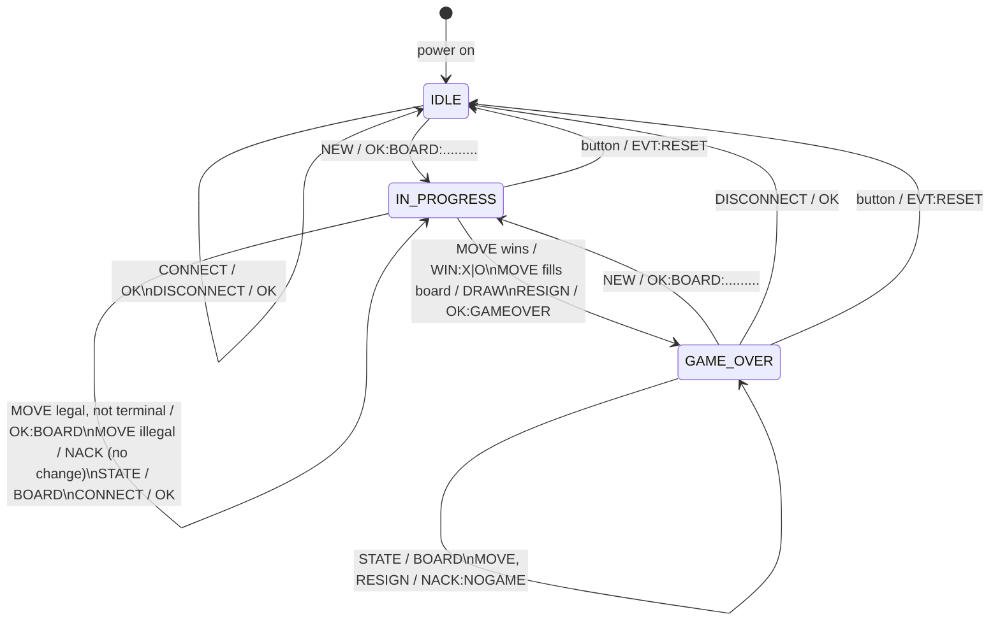
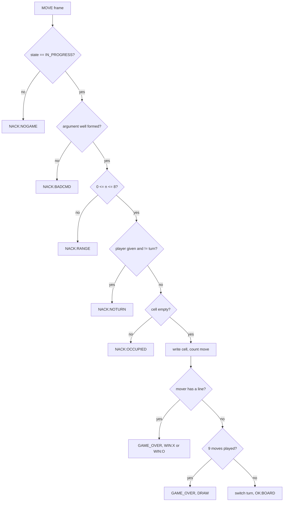
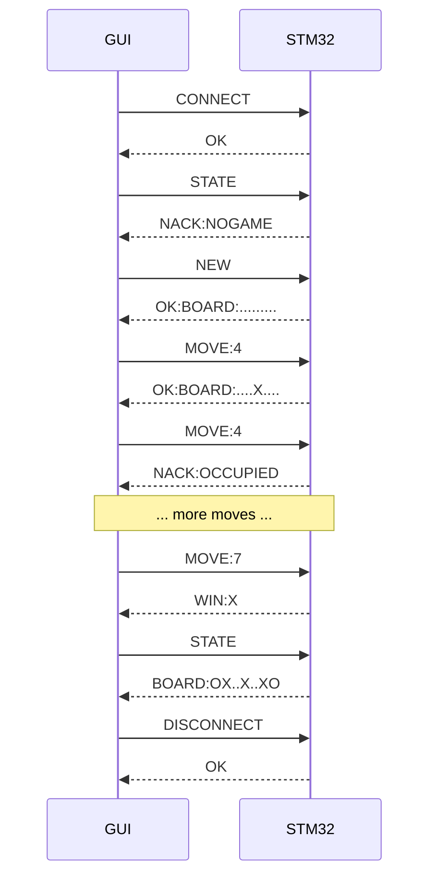

# Message protocol and server state machine

## Physical link

| Item | Value |
|---|---|
| Interface | USART1 on the STM32F051 (PA9 TX, PA10 RX), to the PC through the board's USB-UART / virtual COM port |
| Settings | 115200 baud, 8 data bits, no parity, 1 stop bit, no flow control |
| Character set | Printable ASCII (0x20 to 0x7E) |

## Framing

| Rule | Server behaviour |
|---|---|
| Terminator | `\n` or `\r` ends a frame, so `\r\n` works too (the empty frame between them is ignored) and Enter works in any terminal, e.g. PuTTY. |
| Blank line | Ignored, no reply. |
| Maximum length | 32 bytes before the `\n`. A longer frame is dropped whole up to its `\n` and answered with `NACK:TOOLONG`. |
| Timeout | A frame with no new byte for 1000 ms is discarded and answered with `NACK:TIMEOUT`. |
| Non-printable byte | The frame is answered with `NACK:BADCMD` at its `\n`. |
| UART error / lost byte | The current frame is poisoned and answered with `NACK:BADCMD` at its `\n`. |
| Checksum (optional) | Suffix `*HH`: XOR of every byte before `*`, two upper-case hex digits. Example: `NEW*5C`. A wrong or malformed checksum gives `NACK:CHECKSUM`. Frames without `*` are accepted unchecked. |
| Reply | Exactly one reply line per non-blank frame, ending in `\n`. Replies carry no checksum. |

## Board encoding

Nine characters, cells 0 to 8 row by row, `.` empty, `X` and `O` for the players. X always moves first.

```
0 | 1 | 2
3 | 4 | 5
6 | 7 | 8
```

## Commands and replies

| PC sends | Valid in | Server replies | Effect |
|---|---|---|---|
| `CONNECT` | any state | `OK` | None. Starts a session. |
| `NEW` | IDLE, GAME_OVER | `OK:BOARD:.........` | Empty board, X to move, IN_PROGRESS. |
| `MOVE:<n>` | IN_PROGRESS | `OK:BOARD:<9>` | Plays cell n for the player to move. |
| `MOVE:<P>:<n>` | IN_PROGRESS | same as above | Same, but P (`X`/`O`) must be the player to move. |
| winning move | IN_PROGRESS | `WIN:X` or `WIN:O` | GAME_OVER. |
| ninth move, no line | IN_PROGRESS | `DRAW` | GAME_OVER. |
| `STATE` | IN_PROGRESS, GAME_OVER | `BOARD:<9>` | None. |
| `RESIGN` | IN_PROGRESS | `OK:GAMEOVER` | GAME_OVER. |
| `DISCONNECT` | IDLE, GAME_OVER | `OK` | IDLE, board cleared. |

Unsolicited from the server: `EVT:RESET` when the on-board button is pressed (game abandoned, server back to IDLE).

## Errors

Every error leaves the board, the turn and the state exactly as they were.

| Reply | When |
|---|---|
| `NACK:OCCUPIED` | MOVE to a cell that is not empty. |
| `NACK:RANGE` | MOVE index outside 0 to 8 (for example 9, 42, -1). |
| `NACK:NOTURN` | `MOVE:<P>:<n>` where P is not the player to move. |
| `NACK:NOGAME` | MOVE or RESIGN with no game in progress, or STATE in IDLE. |
| `NACK:STATE` | NEW or DISCONNECT while a game is in progress. |
| `NACK:BADCMD` | Unknown command, wrong case, malformed MOVE argument, non-printable bytes. |
| `NACK:TOOLONG` | Frame over 32 bytes. |
| `NACK:TIMEOUT` | Incomplete frame older than 1000 ms. |
| `NACK:CHECKSUM` | Checksum suffix present but wrong. |

MOVE checks run in this order, and the first failure is reported: game in progress (`NOGAME`), argument well formed (`BADCMD`), range (`RANGE`), turn (`NOTURN`), cell empty (`OCCUPIED`). Only after all pass does the server write to the board.

## Departures from the reference protocol in the brief

1. **`MOVE:<P>:<n>`** names the player explicitly. With one client sending plain `MOVE:<n>`, a move can never be out of turn, so this form is what makes `NACK:NOTURN` reachable and testable. Plain `MOVE:<n>` still works.
2. **`CONNECT` is accepted in every state**, not only IDLE, so a client that restarts mid-game can reconnect and resync with `STATE`.
3. **`DISCONNECT` is also accepted in IDLE.** Mid-game it is refused with `NACK:STATE`; the client resigns first.
4. **Extra errors**: `NACK:STATE`, `NACK:TOOLONG`, `NACK:TIMEOUT`, `NACK:CHECKSUM` make each failure specific.
5. **`EVT:RESET`** reports the button reset to the client.
6. **WIN/DRAW replies do not include the board**, as in the brief. The client sends `STATE` afterwards to draw the final board.
7. **`\r` also ends a frame**, not only `\n`, so a person can type commands in any terminal (PuTTY's Enter key sends only `\r`). The brief only asks for a defined terminator; `\r\n` still works because the empty frame between the two is ignored.

## Server state machine



Move validation branch:



## Typical session



## Hardware behaviour

| Part | Behaviour |
|---|---|
| Button (default PA0, active low, 30 ms debounce) | Abandons any game, returns to IDLE, sends `EVT:RESET`. |
| LED (default PB0) | IDLE off; IN_PROGRESS solid on when X is to move, 1 Hz blink when O is to move; GAME_OVER 5 Hz blink. |
| LCD | Cleared at start-up, so nothing an earlier program wrote stays on it. |
